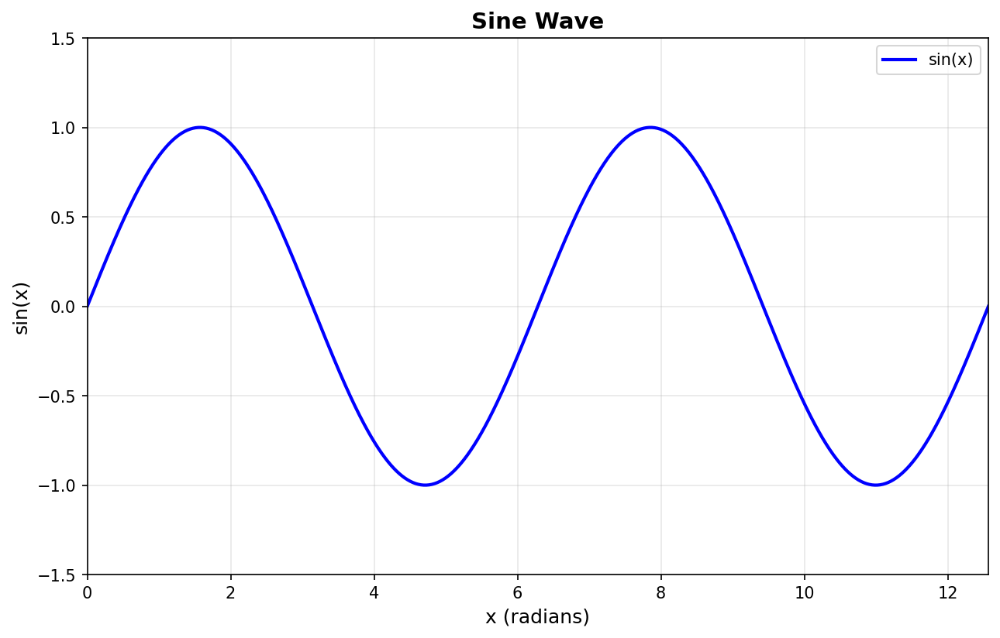

# super-fishstick

本项目包含两个 Python 脚本，用于生成图形图像：

## 功能说明

### 1. 正弦波图像生成 (`generate_sine_wave.py`)

使用 `matplotlib` 和 `numpy` 库生成正弦波图像。

**运行方式：**
```bash
python3 generate_sine_wave.py
```

**输出：**
- `sine_wave.png` - 包含 0 到 4π 范围内的正弦波图像

**依赖：**
```bash
pip install numpy matplotlib
```

### 2. SVG 圆柱体生成 (`generate_cylinder_svg.py`)

使用纯 Python 生成 SVG 格式的圆柱体图像，带有渐变效果以呈现 3D 视觉。

**运行方式：**
```bash
python3 generate_cylinder_svg.py
```

**输出：**
- `cylinder.svg` - 可缩放矢量图形格式的圆柱体图像

**依赖：**
- 无需额外依赖，使用 Python 标准库即可

## 文件结构

```
/workspace
├── README.md                 # 项目说明文档
├── generate_sine_wave.py     # 正弦波生成脚本
├── generate_cylinder_svg.py  # SVG 圆柱体生成脚本
├── sine_wave.png             # 生成的正弦波图像
└── cylinder.svg              # 生成的圆柱体 SVG 图像
```

## 使用方法

1. 克隆或下载本项目到本地
2. 安装所需依赖（仅正弦波脚本需要）：
   ```bash
   pip install numpy matplotlib
   ```
3. 运行相应的脚本生成图像
4. 查看生成的图像文件

## 示例图像

### 正弦波


### 圆柱体
SVG 文件可在浏览器中直接打开查看：
```bash
# Linux/Mac
xdg-open cylinder.svg    # Linux
open cylinder.svg        # Mac

# Windows
start cylinder.svg
```